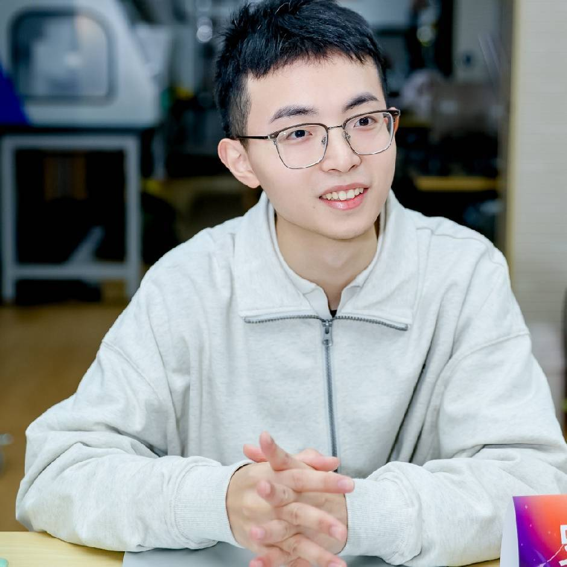
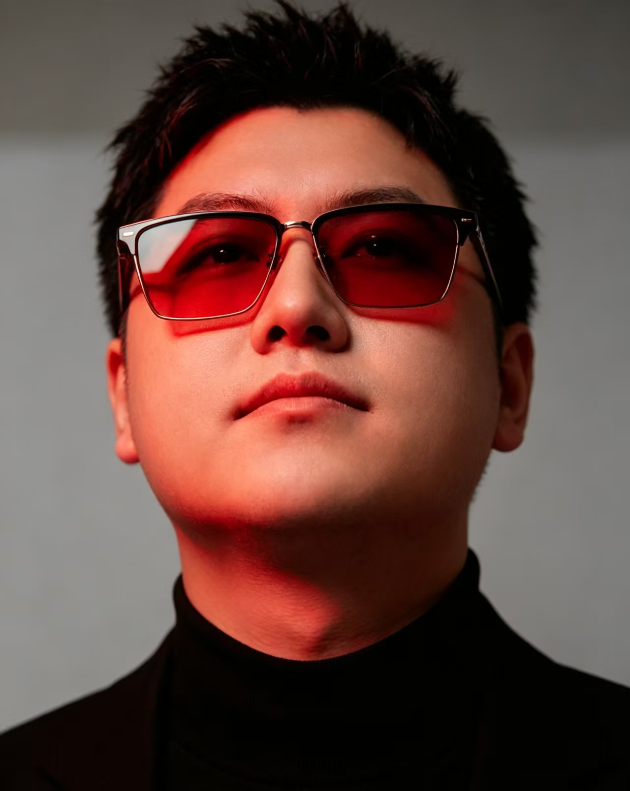

# The People Behind Anywhere Labs

Meet the core members of the Anywhere Labs open-source community.

[Our GitHub](https://github.com/anywhere-labs) · [DeepSeek Harness Desktop](https://github.com/anywhere-labs/deepseek-harness-desktop) · [Agents Anywhere](https://github.com/anywhere-labs/Agents-Anywhere)

## Core Team

<table>
<tr>
<td width="180" align="center" valign="top">
 

  
<strong>t4wefan</strong>
 
Head of Engineering
  
<a href="https://github.com/t4wefan">GitHub ↗</a>
  
</td>
<td valign="top">

### Hi, I'm t4wefan

I build open-source AI infrastructure and developer tools at [Anywhere Labs](https://github.com/anywhere-labs). I lead our technical direction and carry out most of the engineering for [DeepSeek Harness Desktop](https://github.com/anywhere-labs/deepseek-harness-desktop), while also coordinating external contributions and developer relations.

Previously, I was active in the [Koishi](https://koishi.chat/) community, building plugins and community infrastructure. Both Koishi and DeepSeek Harness are built on [Cordis](https://github.com/cordiverse/cordis), making plugin architecture a recurring focus of my work.

**Email:** [t4wefan@qq.com](mailto:t4wefan@qq.com)

<strong>中文介绍</strong>

#### 技术负责人

我在 [Anywhere Labs](https://github.com/anywhere-labs) 开发开源 AI 基础设施与开发者工具，主导 [DeepSeek Harness Desktop](https://github.com/anywhere-labs/deepseek-harness-desktop) 的技术方向，承担主要工程实现，并负责外部贡献者协作与开发者关系。

此前，我长期参与 [Koishi](https://koishi.chat/) 社区，开发插件与社区基础设施。Koishi 与 DeepSeek Harness 均基于 [Cordis](https://github.com/cordiverse/cordis) 构建，插件架构也始终是我持续探索与实践的方向。

**邮箱：** [t4wefan@qq.com](mailto:t4wefan@qq.com)

</td>
</tr>
</table>

<table>
<tr>
<td width="180" align="center" valign="top">
 

  
<strong>Benson Wang</strong>
 
Head of Product
  
<a href="https://github.com/Bensonwang-owl">GitHub ↗</a>
  
</td>
<td valign="top">

### Hi, I'm Benson Wang

I lead product at [Anywhere Labs](https://github.com/anywhere-labs), focusing on [DSH Desktop](https://github.com/anywhere-labs/deepseek-harness-desktop). I shape our product direction and take primary responsibility for product definition—identifying user needs and turning them into clear priorities and feature requirements.

Born in 2006, I'm a second-year computer science student currently on a leave of absence to build a startup in Beijing. Previously, I interned on search algorithms for Douyin at ByteDance and worked as a research assistant at Tsinghua University's Institute for AI Industry Research (AIR), focusing on vision-language-action (VLA) models.

I continue to build open-source AI agents and am currently working on a startup focused on AI agents for finance.

**Email:** [benson@jiuxiangxian.com](mailto:benson@jiuxiangxian.com)

<strong>中文介绍</strong>

#### 产品负责人

我在 [Anywhere Labs](https://github.com/anywhere-labs) 主要负责 [DSH Desktop](https://github.com/anywhere-labs/deepseek-harness-desktop) 的产品工作，主导产品方向，承担绝大多数产品定义工作，包括用户需求梳理、功能规划与优先级制定。

2006 年生，计算机专业大二，目前休学在北京创业。曾任字节跳动抖音搜索算法实习生、清华大学智能产业研究院（AIR）研究助理，研究方向为视觉—语言—动作（VLA）模型。

持续参与 AI Agent 开源建设，目前正围绕金融领域的 AI Agent 创业。

**邮箱：** [benson@jiuxiangxian.com](mailto:benson@jiuxiangxian.com)

</td>
</tr>
</table>

<table>
<tr>
<td width="180" align="center" valign="top">
 

  
<strong>Olando</strong>
 
Head of Community
  
<a href="https://me.dufengyun.xyz">Website ↗</a>
  
</td>
<td valign="top">

### Hi, I'm Olando (Du Liangkuan)

I lead community operations at Anywhere Labs, focusing on day-to-day engagement, community support, and ecosystem growth. As one of the project's early co-initiators, I help maintain an active community and support its continued growth.

**Email:** [2330304961@qq.com](mailto:2330304961@qq.com)

**Website:** [me.dufengyun.xyz](https://me.dufengyun.xyz)

<strong>中文介绍</strong>

#### 社区负责人

我是 Olando（杜亮宽），项目早期联合发起者之一，在 Anywhere Labs 主要负责社区运营、社群维护与生态增长，推动社区日常交流与持续发展。

**邮箱：** [2330304961@qq.com](mailto:2330304961@qq.com)

**个人站点：** [me.dufengyun.xyz](https://me.dufengyun.xyz)

</td>
</tr>
</table>

## Engineering Contributors

Thank you to the contributors whose expertise, dedication, and collaborative spirit help advance our projects and strengthen the Anywhere Labs open-source community.

<table>
<tr>
<td width="25%" align="center">
 

  
<strong>Contributor One</strong>
  
<a href="https://github.com/anywhere-labs">GitHub ↗</a>
  
</td>
<td width="25%" align="center">
 

  
<strong>Contributor Two</strong>
  
<a href="https://github.com/anywhere-labs">GitHub ↗</a>
  
</td>
<td width="25%" align="center">
 

  
<strong>Contributor Three</strong>
  
<a href="https://github.com/anywhere-labs">GitHub ↗</a>
  
</td>
<td width="25%" align="center">
 

  
<strong>Contributor Four</strong>
  
<a href="https://github.com/anywhere-labs">GitHub ↗</a>
  
</td>
</tr>
</table>

## Join Us

We welcome developers, creators, and open-source enthusiasts who share our passion for building the future of AI. Join us to exchange ideas, contribute your expertise, and build meaningful projects together.

**Get in touch:** [benson@jiuxiangxian.com](mailto:benson@jiuxiangxian.com)
